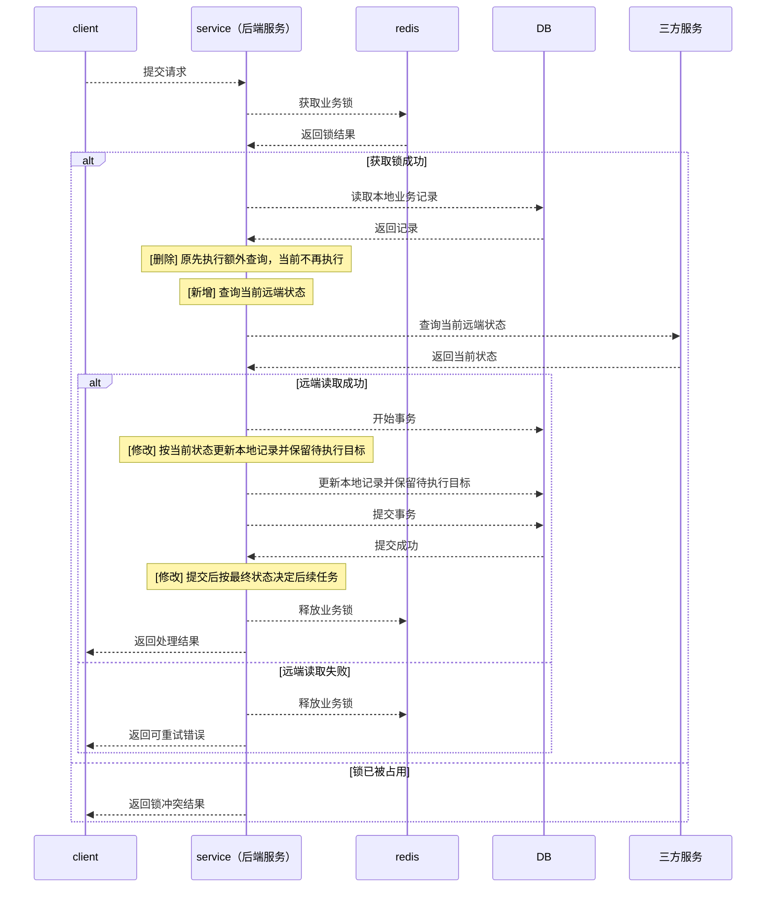

# 文档输出规范

装配和复审前完整读取本文件。最终输出只包含本文件规定的 Markdown 文档。

## 通用规则

- 适用任意后端语言、框架和仓库；不得假设特定模块、表名或接口。
- 不确定的信息标记“待确认”，不得编造。
- 语言简洁，优先使用短句、列表和表格。
- 字段、枚举、参数、映射、状态流、依赖和测试场景优先使用表格。
- JSON 代码块必须使用多行格式，每个字段单独占一行。
- 修改内容章节必须逐文件使用独立标题，不得合并多个文件。
- “业务变化”“目前的逻辑”“之前的逻辑”只描述本次 diff 触及的行为差异；未变化的上游解析、下游调用链、事件分支和副作用不得复述，必要时仅用“继续既有处理”概括。入口时序图展示当前完整交互，按下文规则保留必要的未变化时序。
- 测试文件只描述本次新增或改变的 fixture、helper 和测试，不列出未变化的既有测试。
- 字段表一行一个字段。
- 不输出“注：”、测试执行说明、基线失败说明或迁移副本说明。
- 不输出“已知事项与后续”“后续计划”“背景介绍”或“总结”。

## 固定结构

```markdown
# [功能名]（[一句话限定]）分支变更说明

> 分支：`[branch]`
> 基线：`[base]`（merge base `[sha]`）

## 一、简介

## 二、接口文档

## 三、修改代码涉及入口

## 四、修改内容

## 五、表结构的修改

## 六、测试覆盖情况
```

与变更无关的章节跳过，后续章节顺延编号。

## 一、简介

只列事实，每条一行：

- 新增接口 / 能力 / 表 / 配置 / 任务。
- 修改接口 / 能力 / 表 / 配置 / 任务。
- 删除接口 / 能力 / 表 / 配置 / 任务。

无对应变更的类型不写。

## 二、接口文档

仅记录仓库本地接口文档或代码中实际存在的接口。不得输出 `operationId`、鉴权等级、tags、description 等元信息。

接口文档文件：

- `[api spec path]`

### 2.1 接口定义

按接口逐项列出全部新增接口和全部修改接口的当前最新完整定义。

字段变更标记：

- 🟩 新增：当前请求体或当前返回体中的新增字段。
- 🟧 修改：当前请求体或当前返回体中类型、结构或约束发生变化的字段。
- 🟥 删除：原始请求体或原始返回体中被删除的字段。

`[METHOD] [PATH]`

当前请求体：

```json
{
  "[field]": "[type / value]",
  "[new field]": "🟩 新增 / [type / value]",
  "[changed field]": "🟧 修改 / [type / value]"
}
```

当前返回体：

```json
{
  "[field]": "[type / value]",
  "[new field]": "🟩 新增 / [type / value]",
  "[changed field]": "🟧 修改 / [type / value]"
}
```

修改接口紧接着列出基线定义：

原始请求体：

```json
{
  "[field]": "[type / value]",
  "[deleted field]": "🟥 删除 / [type / value]"
}
```

原始返回体：

```json
{
  "[field]": "[type / value]",
  "[deleted field]": "🟥 删除 / [type / value]"
}
```

新增或修改接口组为空时写“无”。删除接口只列方法和路径：

`~~[METHOD] [PATH]~~`

规则：

- 修改接口的字段定义完全无变化时，接口下方写“接口无变动。”，仅列一次请求体和返回体，不输出当前和原始两套定义。
- 修改接口存在字段新增、修改或删除时，顺序固定为当前请求体、当前返回体、原请求体、原返回体。
- JSON 只展示真实请求体和返回体。
- 嵌套字段完整展开。
- 当前请求体和当前返回体中的新增字段必须在类型值前标记 `🟩 新增 /`，修改字段必须标记 `🟧 修改 /`。
- 原始请求体和原始返回体中被删除的字段必须在类型值前标记 `🟥 删除 /`；未删除字段不加标记。
- 仅业务行为变化但字段定义、类型、结构和约束未变化时，不得添加字段变更标记。
- 字段标记放在 JSON 字符串值内，不得使用 JSON 不支持的注释语法，确保代码块仍是合法 JSON。

## 三、修改代码涉及入口

以下列出全部修改代码涉及的入口。

图例：


文件变更图示例：


文件变更图规则：

- 只覆盖参与代码或业务逻辑的新增、修改、删除文件。
- 纯文档、生成产物、迁移文件和配置文件排除。
- 列出全部修改代码涉及的入口，从实际入口文件开始展示对应调用流程。
- 每个入口标题下必须先明确写出 `变更入口：[入口标识]`，再写出 `协议是否变更：是` 或 `协议是否变更：否`。
- `变更入口` 的值必须使用实际入口标识：接口填写完整路由（例如 `POST /v1/billing/subscriptions`），consumer 填写 consumer 名称；其他入口按实际入口名称填写。
- 入口标题下的固定字段格式如下：

  ```text
  变更入口：StripeWebhookConsumer
  协议是否变更：否
  ```
- 同一文件参与多个流程时重复体现。
- 无法关联入口的代码或业务逻辑文件不得省略，单独标记“入口待确认”。
- “入口待确认”按未关联入口分组；同一文件参与多个流程时分别放入每个流程。
- 节点标签只写文件名，不写路径、方法、接口地址或说明。
- 图例必须使用 Mermaid 色块示例，不直接以颜色名称或 emoji 代替；图例和流程图的 `classDef` 名称、颜色、边框及文字样式必须完全一致。
- 图例的四个色块横向排列：使用 `flowchart LR`，并添加不可见连线 `added ~~~ modified ~~~ unchanged ~~~ deleted` 固定顺序。仅设置 LR 而不连接节点仍可能纵向堆叠。入口章节和表结构章节均使用此图例。
- 绘图后核对每个代码或逻辑变更文件均已入图。

### 入口完整时序图

每个已确认入口按以下顺序输出：入口标题、`变更入口`、`协议是否变更`、文件变更图、`完整时序：`、Mermaid `sequenceDiagram`。时序图紧接对应文件变更图，不集中到章节末尾。

参与者粒度：

| 角色 | 表达范围 |
| --- | --- |
| client | 实际发起请求的客户端；没有客户端参与的 consumer 或后台任务不声明此角色。 |
| service（后端服务） | 后端处理、业务编排和内部判断；同一服务的 handler、application、repository 不拆成参与者。确有跨后端服务调用时按实际服务分别声明。 |
| DB | 实际数据库交互，包括查询、事务内写入、提交或回滚。 |
| redis | 实际 Redis 缓存、幂等记录或锁交互。 |
| agent | 实际参与的智能体；不能把普通定时任务、consumer 或 worker 自动归为 agent。 |
| 三方服务 | 实际外部服务，可按名称分别声明，如 `三方服务（Shopify）`、`三方服务（SQS）`。 |

- 只声明实际参与当前入口时序的角色；不出现的角色直接省略，不输出空泳道。参与者以角色或具体系统命名，不使用文件名、函数名或内部层级名。
- 按当前代码展示从实际请求／消息／调度触发，到响应返回、消息处理结果或任务结束的完整业务交互。服务内部触发用 `Service-->>Service` 自身虚线箭头表示，不虚构 client 或 agent。
- 包含必要的未变化交互，使读者能独立理解完整流程；不把时序图缩减为变更片段，也不展开每个内部方法调用。
- 展示实际存在的主要成功、跳过、失败和重试分支，使用 `alt`、`opt`、`loop` 或 `par`；只在代码确实并发时使用 `par`。事务提交／回滚、锁获取／释放以及提交后的外部副作用按真实顺序展示。
- 影响是否创建、复用、跳过、退款取消或继续后续步骤的条件必须显式画出 `alt/else`，不能只在箭头说明中写“仅当……”。同一恢复事务中的记录存在／缺失和退款／未退款要区分；失败分支不得视觉上落入成功依赖步骤。
- 变更统一使用 `Note over Service: [新增] / [修改] / [删除] 变更说明` 的说明框，紧邻对应交互或分支。只在说明框内放变更标记，不在箭头文字、`alt` / `opt` / `loop` 等分支标题中放标记；不按整个角色标记。说明框描述变化，箭头只描述实际交互，分支标题只描述当前条件。未变化步骤不添加变更说明框。
- 方框只用于新增、修改、删除的变更说明；普通说明、内部处理、跳过和任务结束全部使用虚线箭头。同一角色内部步骤使用自身箭头，例如 `Service-->>Service: 跳过处理`；跨角色请求与返回均使用 `-->>`。分支结构继续使用 `alt` / `opt` / `loop`，标题只写条件。不得用普通 `Note` 方框描述未变化行为。
- 同步调用必须成对展示请求及返回：数据库读取／写入、Redis 操作、三方 API 查询／修改都要画返回，说明实际结果、成功确认或错误。返回同样使用虚线箭头。消息发布只画发布 API 的入队确认，不当作下游业务已完成；异步投递不虚构业务返回。自身处理箭头不用再画返回。
- 已删除的交互用 `Note over` 标记 `[删除] 原先……，当前不再执行`，放在原对应位置附近；不画成当前仍会执行的消息，也不为已完全移除的角色保留空泳道。
- 不混用 `rect` 背景作为第二套变更标识；新增、修改、删除均使用相同形式的说明框和文字前缀。`classDef` 图例仅适用于文件变更图，不用于时序图。
- 没有行为变化、只有文件组织或声明变化的入口，时序按实际逻辑绘制，使用自身虚线箭头说明“时序无变动”，不伪造变更消息。来源或顺序不确定时明确写“待确认”，不得补造调用；入口本身未确认时保留“入口待确认”。

时序示例（仅演示格式，角色和交互必须按实际代码取舍）：



## 四、修改内容

逐项列出全部变更文件，按新增、修改、删除分组。代码、业务逻辑、配置、迁移、测试、纯文档和生成产物均不得省略。

文件即使已出现在接口、流程、表结构或测试章节，也必须在本章再次列出。

任一分组为空时，该分组标题下写“无”。

### 4.1 新增文件

#### `[file path]`

- 业务职责：[业务能力、业务对象或用户动作]。
- 实现职责：[技术职责以及如何支撑业务]。
- 核心用例：主流程用 `[A] → [B] → [C]`。
- 按实际维度列出入参校验、状态校验、幂等、外部调用、失败处理、事务边界、提交后副作用等。

### 4.2 修改的文件

#### `[file path]`

业务变化：

- [业务场景和业务规则现在如何工作]。
- [之前的业务场景和业务规则如何工作]。

目前的逻辑：

- [本次修改后的行为差异及其直接业务结果、状态变化或副作用]。

之前的逻辑：

- [同一行为差异在基线中的逻辑]。

规则：

- 每个修改文件必须同时写清业务描述、之前逻辑和目前逻辑。
- 只写本次 diff 改变的行为，不复述未变化的上游解析、下游调用链、事件分支或副作用；需要说明继续既有处理时，仅写“继续既有处理”。
- 只描述新增依赖、注册接口或声明实现等技术事实不算业务描述。
- 无法确认业务语义时标记“待确认”。

### 4.3 删除的文件

#### `[file path]`

- [为什么删除]。

## 五、表结构的修改

图例：


迁移 / Schema 来源：

- `[migration or schema file]`

### 5.1 修改表：`[schema.table]`

全字段按物理顺序列出：

| 字段 | type\|null\|default | 变更 |
| --- | --- | --- |
| `[field]` | `[type] / [null] / [default]` | 无变动 |
| `[field]` | `[old type] / [old null] / [old default]` | 删除 |
| `[field]` | `[new type] / [new null] / [new default]` | 新增 |

约束与索引变更：

| 名称 | 类型 | 之前 | 现在 |
| --- | --- | --- | --- |
| `[name]` | `[constraint / index type]` | `[before]` | `[after]` |

规则：

- 变更列只写 `新增`、`无变动` 或 `删除`，不写说明；表格使用图例对应文字，不依赖 emoji 或颜色渲染。
- 不存在“修改字段”状态；修改必须拆成删除行和新增行。
- 字段、约束、索引必须列全。

### 5.2 新增表：`[schema.table]`

全字段：

| 字段 | type\|null\|default | 变更 |
| --- | --- | --- |
| `[field]` | `[type] / [null] / [default]` | 新增 |

索引：

| 名称 | 类型 | 内容 |
| --- | --- | --- |
| `[name]` | `[index type]` | `[columns and conditions]` |

### 5.3 删除表：`[schema.table]`

- `[why removed]`

## 六、测试覆盖情况

只逐项列出本分支相对基线新增的测试用例。修改、重命名或未变化的测试文件及测试用例不得列出。测试文件本身有变更但没有新增测试用例时，不列该文件。没有新增测试用例时只写“无”。

测试场景必须说明业务输入、状态、权限、数据隔离、外部调用、错误处理、事务结果或具体技术断言。不得使用“覆盖对应方法的行为”或“验证方法正常工作”等泛化表述。

### 6.1 [测试类型]：`[test file path]`

| 测试 | 覆盖场景 |
| --- | --- |
| `[test name]` | `[scenario]` |

## 最终回复

- `delivery.mode=full_markdown`：最终回复只包含已复审的完整 Markdown 文档。
- `delivery.mode=file_path`：最终回复说明 Markdown 文件已输出到仓库根目录下，并附简短完成信息。

不得附加技能说明、测试执行说明、进度说明或后续计划。
